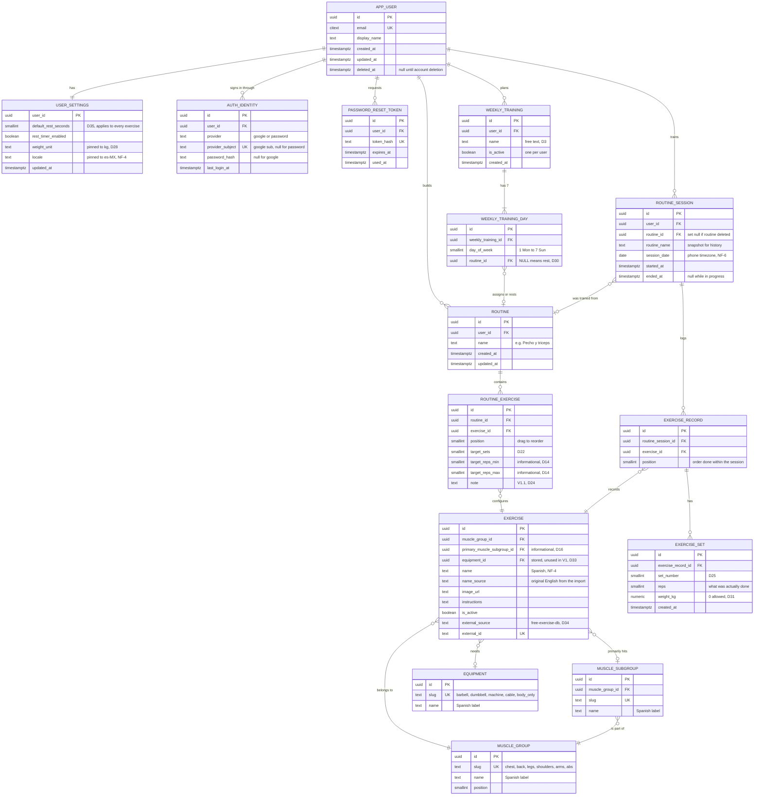

# Data model

**Version:** v1 · October 16, 2026
**Source of truth for:** tables, columns, keys, constraints and indexes.
**Derived from:** [`SRS.md`](SRS.md) §5 and the decisions in §4. If this document and the SRS disagree, the SRS wins on *what* and this one wins on *how it's stored*.

If you are reading this to *learn* the model rather than to build from it, start with [`DATA-MODEL-EXPLAINED.md`](DATA-MODEL-EXPLAINED.md) instead — same model, no SQL, worked through one training day row by row.

Two views of the same thing:

- The **Mermaid diagram** below, which renders anywhere Markdown does and is easy to diff in a pull request.
- A **drawn version** at [`assets/data-model.html`](assets/data-model.html): the tables grouped by zone, with the catalog in the middle because it is the only thing Plan and Reality share, and the relationships routed as real lines instead of guesses. It zooms, fits to the window, and hovering a table isolates its relationships. Open it in a browser — Mermaid gets vague once there are fifteen tables.

## Conventions

| | |
|---|---|
| Names | `snake_case`, singular table names (`routine`, not `routines`) |
| Primary keys | `uuid`, generated by the app or the database. Never a sequence exposed in a URL |
| Timestamps | `timestamptz` for instants, `date` for calendar days |
| `created_at` / `updated_at` | On every table that a user mutates. Omitted on catalogs and join rows where it carries nothing |
| Money / weights | `numeric(6,2)` for kilograms. Never float |
| Deletes | Stated per relationship. Anything that would erase history is `set null` plus a snapshot, never `cascade` |

Two names deserve an explanation: the table is **`app_user`** and not `user` because `user` is a reserved word in PostgreSQL, and **`exercise_set`** and not `set` for the same reason. Everywhere else the table name matches the entity name from the SRS glossary.

---

## The four zones

Every table belongs to one of four zones, and the zone tells you who owns the row:

| Zone | Who owns it | Tables |
|---|---|---|
| **Account** | One user | `app_user`, `auth_identity`, `password_reset_token`, `user_settings` |
| **Plan** | One user | `weekly_training`, `weekly_training_day`, `routine`, `routine_exercise` |
| **Reality** | One user | `routine_session`, `exercise_record`, `exercise_set` |
| **Catalog** | **Everyone** — shared, read-only for users | `muscle_group`, `muscle_subgroup`, `equipment`, `exercise` |

**Every user-owned table reaches `app_user`.** Plan and Reality tables either hold `user_id` directly or hang off a parent that does. Catalog tables hold no `user_id` at all, by design (D34): there is one catalog and every user reads the same one.

The only bridge between Plan and Reality is the **catalog `exercise`**. That is deliberate (D9): progress survives any change of plan because `exercise_record` points at the exercise, never at the routine.

---

## Diagram



---

## Table notes

Only the things the diagram can't say.

### `app_user`

`email` is `citext` so `Alger@x.com` and `alger@x.com` are the same person — which is what makes the account-linking rule in FR-1 work at all.

`deleted_at` is there so account deletion can be a two-step: flag now, purge later. If you'd rather delete immediately, drop the column and let the cascades do it — every user-owned table cascades from here.

### `auth_identity`

This is the table that satisfies "if someone signed up with Google and then uses email/password with the same address, the accounts are linked" (FR-1). One `app_user`, several ways in.

- `unique (provider, provider_subject)` — one Google account can't be two users
- `unique (user_id, provider)` — one user can't have two password identities
- `check` — `password` rows have `password_hash` and no `provider_subject`; `google` rows the reverse

### `user_settings`

One row per user, created with the account. `user_id` is both PK and FK, which is how you get a real 1-to-1 instead of a 1-to-many you have to remember to keep at one row.

`weight_unit` and `locale` are **future-proofing and droppable**. D28 and NF-4 pin them to `kg` and `es-MX`, so today they're constants. They cost two columns and save a migration if that ever changes. If you'd rather not carry dead columns, delete them — nothing reads them in V1.

### `weekly_training`

"Only one active per user" (D3) is an index, not application code:

```sql
create unique index weekly_training_one_active_per_user
  on weekly_training (user_id)
  where is_active;
```

### `weekly_training_day`

Exactly 7 rows per weekly training, created together with the parent. `unique (weekly_training_id, day_of_week)` stops duplicates; the "exactly 7" part is an application invariant — creating the parent creates its 7 days in the same transaction.

**`routine_id` is `on delete set null`.** Deleting a routine that some day points at turns that day into rest. It does not block the delete and it does not cascade into the weekly training. This is what makes "deleting a routine doesn't break anything" true (FR-3).

### `routine_exercise`

- **No unique on `(routine_id, exercise_id)`.** The same exercise is allowed twice in one routine — heavy at the start, lighter at the end. That case is exactly what the `note` field is for (D24).
- `unique (routine_id, position)` should be **deferrable**, or reordering three exercises means fighting the constraint halfway through the transaction.
- `check (target_reps_min <= target_reps_max)` and `check (target_sets between 1 and 20)`.
- **It stores no name** (D23). The name comes through `exercise_id`.

### `routine_session`

Two columns here look redundant and are not:

- `routine_id` is the live reference, `on delete set null`.
- `routine_name` is a **snapshot taken when the session is created**.

The snapshot is on purpose, and it is the opposite call to the one in `routine_exercise`, which deliberately does *not* copy the name. The difference is what the two things are. `routine_exercise` is a live part of a plan, so it should always show the current catalog name. A finished session is a **historical fact**: "on Monday October 6 you trained Espalda y bíceps" stays true even after you rename or delete that routine. Copying the name there is the only way history survives (FR-3, FR-7).

`ended_at` is null while a session is in progress. Duration is `ended_at - started_at` and is never stored (§10.2).

**Open invariant:** nothing currently prevents two sessions on the same date. The SRS doesn't address it. If one-per-day is the rule, add `unique (user_id, session_date)`; if morning-and-evening should be possible, leave it. Worth settling before the first migration.

### `exercise_record`

- `routine_session_id` is `on delete cascade` — deleting a session takes its records and sets with it.
- `exercise_id` is `on delete restrict`. A catalog exercise that somebody has logged can never be hard-deleted; that's what `exercise.is_active` is for.
- `position` is the order the exercises were actually logged in. The routine already has an order, but the session keeps its own so the history reads the way the day really went.

### `exercise_set`

- `unique (exercise_record_id, set_number)`.
- `check (reps > 0)` and `check (weight_kg >= 0)` — zero is valid and meaningful (D31): a bodyweight pull-up with nothing hanging off you.
- A set that was never filled in simply has no row (D32).

### `exercise` and the catalog

- `unique (external_source, external_id)` is what makes the import re-runnable: a second import updates rows instead of duplicating them (D34).
- `name` is the translated Spanish label; `name_source` keeps the original English so a bad translation can be traced back.
- `is_active` retires an exercise without deleting it, which `on delete restrict` above requires.
- **Cross-table invariant the database can't express in a plain `check`:** `primary_muscle_subgroup_id` must belong to the same `muscle_group_id` as the exercise. Either a trigger or an application rule — pick one, but pick it, because a dumbbell curl filed under "legs" with a "biceps" subgroup will silently wreck the catalog navigation (FR-2).

---

## What is NOT stored

Four things look like they want columns and shouldn't have them. All four are queries.

| Thing | Where it comes from |
|---|---|
| **Session duration** | `ended_at - started_at` |
| **Progress chart point** | `max(weight_kg)` per `session_date`, per exercise, per user (D9) |
| **Heaviest-weight record** | `max(weight_kg)` over all of that user's sets for that exercise (FR-8) |
| **Previous-session prefill** | The most recent `exercise_record` for that user and exercise (D21) |

The progress chart, which is the heaviest of the four:

```sql
select rs.session_date,
       max(es.weight_kg) as max_weight
from   exercise_set es
join   exercise_record er on er.id = es.exercise_record_id
join   routine_session rs on rs.id = er.routine_session_id
where  rs.user_id = $1
  and  er.exercise_id = $2
  and  rs.session_date >= $3
group  by rs.session_date
order  by rs.session_date;
```

And the prefill, which runs on every exercise as you open the logging screen, so it's the one to watch:

```sql
select es.set_number, es.reps, es.weight_kg
from   exercise_set es
join   exercise_record er on er.id = es.exercise_record_id
join   routine_session rs on rs.id = er.routine_session_id
where  rs.user_id = $1
  and  er.exercise_id = $2
  and  rs.ended_at is not null
order  by rs.session_date desc, es.set_number
limit  20;
```

---

## Indexes

Beyond the primary keys and the unique constraints already listed:

```sql
create index on auth_identity (user_id);
create index on weekly_training_day (weekly_training_id);
create index on routine_exercise (routine_id, position);
create index on routine_session (user_id, session_date desc);
create index on exercise_record (routine_session_id);
create index on exercise_record (exercise_id);
create index on exercise_set (exercise_record_id, set_number);
create index on exercise (muscle_group_id) where is_active;
```

The two progress queries above both walk `set → record → session` and filter on `rs.user_id`, which means the user filter sits at the far end of two joins. Those indexes cover it at the scale of one person's training history, which is a few thousand rows a year.

**If it ever gets slow, the first move is to carry `user_id` down onto `exercise_record`** and index `(user_id, exercise_id)`. It is denormalization, and it is the right kind: the value never changes once written. Don't do it until the query actually hurts.

---

## Seed data

Three catalog tables ship with the app rather than being created by users.

| Table | Rows | Where from |
|---|---|---|
| `muscle_group` | **6** — chest, back, legs, shoulders, arms, abs (D26) | Written by hand |
| `equipment` | ~12 — barbell, dumbbell, machine, cable, body only, bands, kettlebell, medicine ball, exercise ball, e-z curl bar, foam roll, other | The `free-exercise-db` enum |
| `muscle_subgroup` | ~17 mapped onto the 6 groups | Derived from `free-exercise-db`'s `primaryMuscles` |
| `exercise` | ~120–150, trimmed from 800+ | `free-exercise-db`, MIT license (D34) |

The import is a one-off script that is safe to re-run, which is what `unique (external_source, external_id)` buys. Translating the names and checking that each exercise landed under the right muscle group is manual work and belongs to Carlos (FR-2).
